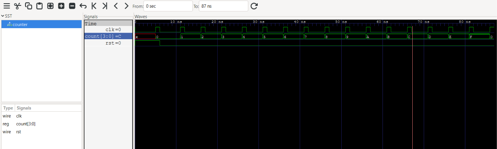

# RTL Design

A collection of digital design projects and exercises developed using **Verilog/SystemVerilog**, with a focus on RTL design, simulation, and functional verification.

This repository documents my progress in digital hardware design, from fundamental RTL modules to more complex digital systems. Each project aims to reinforce hardware description, synchronous design principles, and verification techniques through practical implementation.

## Objectives

- Develop RTL modules using Verilog and SystemVerilog.
- Strengthen understanding of combinational and sequential logic.
- Practice synchronous design principles, including clocks, resets, registers, and finite state machines.
- Build testbenches and automate functional verification.
- Analyze simulation waveforms to understand and debug circuit behavior.
- Apply structured development practices using Git and reproducible simulation workflows.
- Progress toward the design and verification of more complex digital systems.

## Tools and Technologies

| Tool | Purpose |
|---|---|
| Verilog / SystemVerilog | RTL design and hardware description |
| Icarus Verilog | RTL compilation and simulation |
| cocotb | Python-based testbenches and functional verification |
| GTKWave | Simulation waveform visualization |
| Git / GitHub | Version control and project documentation |

## Resources
> These are some of the resources used in this repository

|Resource|Description|
|--------|-----------|
|[HDLBits](https://hdlbits.01xz.net/wiki/Main_Page)|Online platform providing Verilog practice exercises and tutorials for digital logic design|
|[Explore VLSI](https://www.youtube.com/@Explore_VLSI)| Youtube channel |
|[Cocotb](https://docs.cocotb.org/en/stable/index.html)| Cocotb official documentation|
